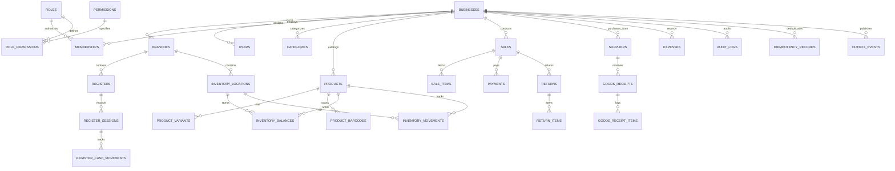

# Universal POS Database ERD & Schema Documentation

The platform uses PostgreSQL 15+ with strict multi-tenant isolation, composite foreign keys, and an append-only inventory ledger.

## Core Schema Rules & Guarantees
1. **Tenant Isolation:** Every business-owned entity carries `business_id UUID NOT NULL REFERENCES businesses(id)`.
2. **Composite Foreign Keys:** References such as `(business_id, product_id)` enforce that a branch or sale cannot reference products belonging to a different business.
3. **Monetary Precision:** All amounts, prices, and rates use `NUMERIC(19, 4)` to eliminate IEEE 754 floating-point inaccuracies.
4. **Append-Only Inventory Ledger:** `inventory_movements` is strictly append-only. Corrections require compensating adjustments.
5. **Operational Projections:** `inventory_balances` is updated transactionally with `FOR UPDATE` row locks to prevent overselling.
6. **Historical Sale Line Snapshots:** `sale_items` snapshots unit cost, unit price, tax, and discount at the exact moment of sale.
7. **Cash Reconciliation:** Register sessions reconcile closing cash against immutable `register_cash_movements`.
